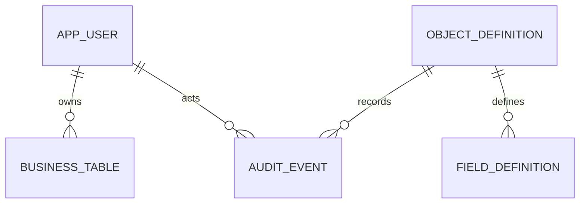

# PLAT-000-S1：第一阶段可运行骨架

日期：2026-10-12，Asia/Shanghai。用户授权后续任务由 Codex 负责，骨架完成后再交 ChatGPT 审查；同时明确保留自有品牌、客户私有化交付及闭源业务扩展空间。

用户收窄首期验收为：登录、数据库架构、对象管理器、前台主页列表、单据详情展示。本文件记录这一阶段的实现与边界，不将它当作完整平台验收。

## 路线与本阶段选型

S1 采用 BUILD_CORE：自行实现业务对象目录、发布和统一数据入口，直接依赖成熟组件。此前 PLAT-000-PRE 的 INSUFFICIENT_EVIDENCE 报告保留在固定提交 `60cebb16deed79b059b52fe1784412bd2cc951d5`；没有将有限调研改写成“证明所有平台不适合”。没有引入候选源码、购买商业模块或接受 OEM 合同。

登录在此阶段使用 Spring Security 的数据库账号与会话，满足当前范围。此前建议的 Keycloak/OIDC、Flowable、Spring AI MCP 保持后续选型，尚未引入依赖或实现，不计作已完成。账户与实际业务授权保持不同职责，后续外部身份需映射为平台用户。

| 项目 | 实际基线 |
|---|---|
| JVM / 构建 | Temurin 25.0.4.1、Maven 3.9.16、项目内 PowerShell 包装脚本 |
| 后端 | Spring Boot 4.1.1、Spring MVC、Spring Security；版本跟随 Boot BOM |
| 数据访问 | jOOQ 3.21.7 动态 SQL、Spring JDBC 事务、HikariCP |
| 数据库 | PostgreSQL 18.x；本机真实验证为 18.1，专用 127.0.0.1:55433 |
| 迁移 / 会话 / JSON | Flyway 12.4.0、Spring Session JDBC 4.1.1、Jackson 3 |
| 前端 | React 19.3.0、TypeScript 6.0.3、Vite 8.3.4 |
| 界面 | Ant Design 6.6.5、icons 6.3.4；中文、系统字体、蓝色/深色导航 |
| 请求 / 路由 | Fetch、TanStack Query 5.104.2、React Router 7.18.4 |
| 金额 | 后端 BigDecimal/NUMERIC、JSON 字符串、前端 decimal.js 10.6.0 |
| 工具 | 本机 Node 24.13.0、pnpm 12.11.2、ESLint 10.12.0、typescript-eslint 8.71.1 |
| 验证 | JUnit 6 的真实 HTTP/PG 测试、Playwright 1.64.0 的真实浏览器验收 |

直接前端依赖和完整解析图见 `web/package.json`、`web/pnpm-lock.yaml`。后端以 `backend/pom.xml` 的固定 Boot parent 管理依赖，不把各组件最新版本随意拼接。完整运行证据与限度见 [验证记录](VALIDATION-S1.md)。

## 可用功能

- 登录、错误密码提示、退出、受保护页面、数据库持久会话、CSRF；管理员与业务用户两种角色。
- 对象目录：创建对象草稿，编辑显示名称/说明，添加七种字段，编辑未发布字段，移除未发布字段。
- 字段：文本、多行文本、小数/金额、整数、日期、勾选框、选项（稳定机器值/显示标签）。
- 发布：创建强类型物理表；已发布对象追加字段；DDL、字段激活、结构版本和审计在同一 PG 事务中提交。失败不吞异常，旧版本保留。
- 列表：动态列、权限过滤后的数量、分页、文本搜索、刷新、记录新建。
- 详情：动态字段、系统记录信息、操作历史、编辑、乐观锁冲突处理、金额与纯日期保真。
- 响应式：桌面和375px视口；侧栏/移动抽屉、可见标签、键盘焦点、减少动画设置。

已发布字段此阶段仅改显示名称；改类型/必填/选项集合、删除已发布字段、对象删除、字段排序、复杂布局等需要后续迁移/配置治理，不提供危险的直接改表按钮。

## 架构边界

后端单一应用，按 identity / metadata / runtime / audit / bootstrap 包组织。对象与字段是运行时数据，不为每个业务对象生成 Java entity/controller 或前端专属页面。

物理表名由不可变对象 UUID 生成 `lcp_business.biz_<uuid>`，列由字段 UUID 生成 `f_<uuid>`。API 名称用于元数据寻址，不直接拼入 SQL 标识符。jOOQ 数据查询与写入使用参数绑定；发布 DDL 仅使用这些内部标识符和已校验的类型/精度。

每次业务请求从认证主体解析平台用户，并读取账号当前状态/角色。客户端不能设置 owner；普通用户只读写自己创建的记录，管理员可访问全部。本阶段不是完整 Profile/Permission Set、字段权限、组织共享或跨 Flow/MCP 权限验收。

元数据每次从 PG 读取，暂无独立缓存，以减少首期发布一致性变量。对象行锁串行化配置写入和发布。`version` 是结构发布版本，标签变更即时生效并有独立审计。业务记录的 `row_version` 负责编辑冲突；版本不匹配时返回409。

单对象写入和基础变更审计同事务提交。没有实现主明细复合事务、Outbox、完整事件一致性或不可篡改审计，不将 audit_event 的存在算作这些能力通过。

金额只接受符合精度/scale 的十进制字符串，不静默舍入，不用 JSON number 或 JS Number 存储金额。纯日期输出 `YYYY-MM-DD`，时间点输出带时区值，界面按用户浏览器时区展示。

## 数据库结构



`lcp` schema 保存 app_user、object_definition、field_definition、audit_event、Spring Session 表及 Flyway history。`lcp_business` 保存一对象一表的业务数据。选项定义使用 JSONB；普通业务字段不是全部放入 JSON/EAV。DDL 的初期支持范围为新增表/字段，复杂迁移与数据回填另行设计。

## 本机运行

前提：Windows x64、PowerShell 7、Node 24、已安装 PostgreSQL 18 二进制。工具下载和依赖缓存只配置到本项目；原有 Java/Node/PostgreSQL 服务不替换。项目本地 JDK 约200MB，首次准备依赖需要公开下载网络。

```powershell
pwsh -File ./scripts/dev.ps1
```

默认 PG 路径为 `D:\PostgreSQL\18\bin`；不同安装位置通过 `-PostgresBin '<actual bin>'` 提供。脚本创建新 `.local/data/pg-s1` 集群，监听127.0.0.1:55433，创建独立 `lcp_s1_dev` / `lcp_s1_test`。已有5432服务不读取业务表、不改角色/配置。

页面：`http://127.0.0.1:5173`；API：`http://127.0.0.1:8085`。账号为 admin / demo；首次自动生成的密码在忽略的 `.local/runtime.json`，不提交仓库。首次 bootstrap 只插入缺失账号，不覆写已有密码。示例采购申请与验收单据均为合成数据，真实业务数据禁止用于此阶段。

停止预览：`pwsh -File ./scripts/stop-preview.ps1`；停止专用PG：`pwsh -File ./scripts/stop-database.ps1`。预览 PID 操作校验所属工作目录，不杀其他项目进程。停止保留数据和文件，不删除集群。

开发脚本仅是本机预览。生产部署还需身份接入决策、迁移/运行角色分离、TLS、备份恢复及安全验收；当前开发集群角色有该独立集群管理权限。

## 验证入口与交付

```powershell
pwsh -File ./scripts/test-backend.ps1
pwsh -File ./scripts/pnpm.ps1 --dir web run build
pwsh -File ./scripts/pnpm.ps1 --dir web run lint
# 先启动真实API和前端，再运行浏览器验收
pwsh -File ./scripts/test-web.ps1
```

CI仅构建与测试，不合并、发布或部署。研究 PR #1 的Head保持不动；S1 使用 `feat/plat-000-s1-platform-skeleton` 分支，从研究固定Head分出。PR为叠加交付，base为 `research/plat-000-pre-oss-selection`，因此不需要先自动合并研究PR。

最终 PR/报告 Base/Head 放 PR 正文、最终回复和忽略的 `artifacts/handoff/PLAT-000-S1-review-request.md`，避免本文件自引用最终SHA。

## 下一阶段待讨论

细粒度对象/字段/记录共享、主明细、统一 Action/MCP、配置环境迁移、Flow/审批、布局与选项依赖、集成/通知/全文搜索。用户本次收窄范围，这些不属于S1完成标准，也不自动恢复全部原PLAT-000目标。
